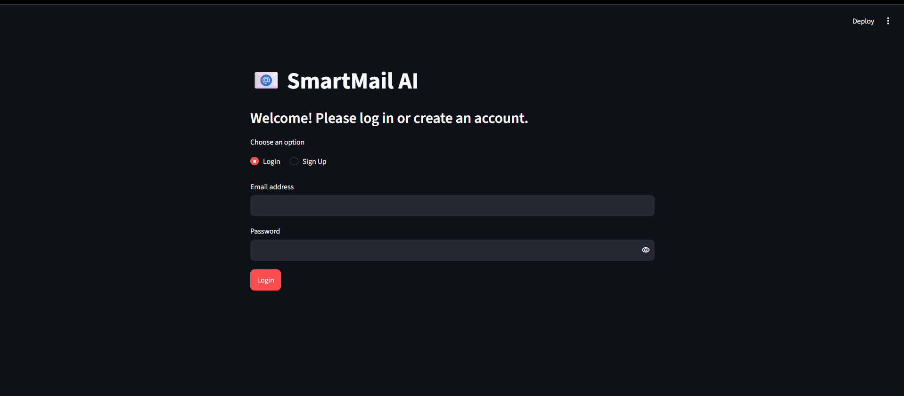

# 📧 SmartMail AI

SmartMail AI is an AI-powered email assistant built with Python and Streamlit. It uses Google's Gemini API to generate professional emails based on the user's email type, purpose, context, and preferred tone.

The application includes secure user authentication, cloud-based email history, search functionality, analytics, individual email downloads, and CSV export through an interactive web interface.

🌐 **Live Demo:** https://smartmail-ai-sumanth.streamlit.app

## 🚀 Features

- 🤖 **AI-Powered Email Generation** using Google Gemini
- 💼 **Multiple Email Types**
  - Job Application
  - Follow Up
  - Leave Request
  - Meeting Request
  - Apology
- 🎨 **Customizable Tone:** Formal, Semi-formal, and Casual
- 🔐 **User Authentication** with Supabase
- ☁️ **Cloud Database Integration** for persistent, user-specific email history
- 📜 **Email History Management** to view previously generated emails
- 🔍 **Search Functionality** to find emails by type, purpose, context, tone, or content
- 📊 **Analytics Dashboard** with email category counts and interactive charts
- 📥 **Individual Email Downloads**
- 📂 **CSV Export** for email history
- 🖥️ **Interactive Streamlit Interface** with sidebar navigation and account controls

## 🛠️ Technologies Used

- **Programming Language:** Python
- **Frontend and Web Framework:** Streamlit
- **AI Integration:** Google Gemini API (`google-genai`)
- **Database and Authentication:** Supabase
- **Data Processing:** Pandas
- **Data Visualization:** Plotly
- **Version Control:** Git and GitHub

## 📸 Screenshots

### 🏠 SmartMail AI Dashboard


### ✉️ Generate Email


### 🔐 User Authentication

**Sign Up**


**Login**



### 📜 Updated Email History


### 📊 Analytics Dashboard


## 📂 Project Structure

```text
SmartMail-AI/
├── assets/
│   ├── SmartMail-AI-Dashboard.png
│   ├── Generate-Email.png
│   ├── Email-history.png
│   ├── Email-Analytics 1.png
│   └── Email-Analytics 2.png
├── .streamlit/
│   └── secrets.toml.example
├── app.py
├── email_generator.py
├── email_templates.py
├── email_templates.txt
├── requirements.txt
└── README.md
```

*Note: This is the documented project structure. Local configuration files, generated history files, and other private files may be excluded from GitHub.*

## ⚙️ Installation and Setup

### 1. Clone the Repository

```bash
git clone https://github.com/Sumanth-153/SmartMail-AI.git
cd SmartMail-AI
```

### 2. Create a Virtual Environment (Recommended)

```bash
python -m venv venv
```

Activate it on Windows:

```bash
venv\Scripts\activate
```

### 3. Install Dependencies

```bash
python -m pip install -r requirements.txt
```

### 4. Configure Application Secrets

Create a `.streamlit/secrets.toml` file in the project directory. Add the required credentials using the variable names expected by the application:

```toml
GEMINI_API_KEY = "YOUR_GEMINI_API_KEY"
SUPABASE_URL = "YOUR_SUPABASE_PROJECT_URL"
SUPABASE_PUBLISHABLE_KEY = "YOUR_SUPABASE_PUBLISHABLE_KEY"
```

Replace the placeholders with your own credentials. Configure the required Supabase database table and access policies before using cloud authentication and email history.

**Security:** Never commit your actual API keys, access tokens, or private credentials to GitHub. Use Streamlit Community Cloud Secrets for the deployed application.

### 5. Run the Application

```bash
python -m streamlit run app.py
```

## 💻 How to Use

1. Open SmartMail AI and create an account or log in.
2. Navigate to **Generate Email**.
3. Select an email type and enter the purpose and relevant context.
4. Choose your preferred tone.
5. Generate and review your email.
6. Download the generated email when needed.
7. Visit **Email History** to browse or search previously saved emails.
8. Open **Analytics** to explore email category statistics.
9. Export your email history as a CSV file.

## 🌐 Live Demo

Try the deployed application:

**[Launch SmartMail AI](https://smartmail-ai-sumanth.streamlit.app)**

## 🔮 Future Improvements

- Gmail integration for sending emails directly
- Multi-language email generation
- Additional email templates and customization options
- More advanced analytics and reporting
- Expanded personalization features

## 👨‍💻 Author

**Sumanth Kotian**

Python Developer | AI Enthusiast | Business Analytics

- **GitHub:** https://github.com/Sumanth-153
- **LinkedIn:** https://www.linkedin.com/in/sumanth-kotian-620225338/

## ⭐ Support

If you find SmartMail AI useful, consider giving the repository a ⭐ on GitHub.
