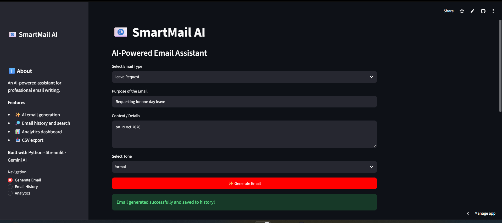
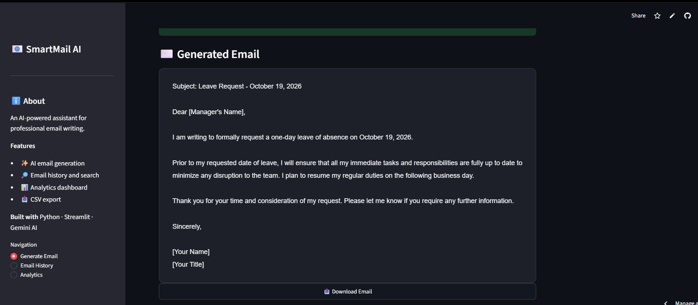
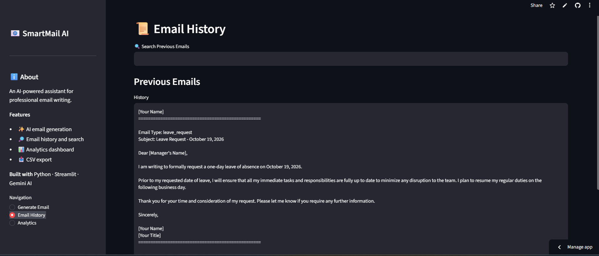

# 📧 SmartMail AI

**SmartMail AI** is an AI-powered email assistant built with Python and Streamlit. It uses Google's Gemini API to generate professional emails based on the user's email type, purpose, context, and preferred tone.

The application also provides email history management, search, analytics, individual email downloads, and CSV export through an interactive web interface.

## 🚀 Features

- 🤖 **AI-Powered Email Generation** using Google Gemini
- 💼 **Multiple Email Types**
  - Job Application
  - Follow Up
  - Leave Request
  - Meeting Request
  - Apology
- 🎨 **Tone Selection:** Formal, Semi-formal, and Casual
- 📜 **Email History** to view previously generated emails
- 🔍 **Search History** to find relevant emails
- 📊 **Analytics Dashboard** with category counts and interactive charts
- 📥 **Download Generated Emails**
- 📂 **Export Email History to CSV**

## 🛠️ Technologies Used

- Python
- Streamlit
- Google Gemini API (`google-genai`)
- Pandas
- Plotly
- Git and GitHub

## 📸 Screenshots


### 🏠 Dashboard


### ✉️ Generate Email


### 🧾 Email History


### 📊 Analytics Dashboard


## 📂 Project Structure

```text
SmartMail-AI/
├── assets/
├── .streamlit/
│   └── secrets.toml.example
├── app.py
├── email_generator.py
├── email_templates.py
├── email_templates.txt
├── requirements.txt
└── README.md
```

*Note: `email_history.txt`, `.streamlit/secrets.toml`, and other local or private files may not be included in the GitHub repository.*

## ⚙️ Installation and Setup

### 1. Clone the repository

```bash
git clone https://github.com/Sumanth-153/SmartMail-AI.git
cd SmartMail-AI
```

### 2. Install dependencies

```bash
pip install -r requirements.txt
```

### 3. Configure your Gemini API key

Create a `.streamlit/secrets.toml` file in the project directory and add:

```toml
GEMINI_API_KEY = "YOUR_GEMINI_API_KEY"
```

Replace the placeholder with your own API key. **Never commit your actual API key to GitHub.**

### 4. Run the application

```bash
python -m streamlit run app.py
```

## 💻 How to Use

1. Select an email type.
2. Enter the purpose and relevant context.
3. Choose your preferred tone.
4. Click **Generate Email**.
5. Review and download the generated email.
6. Browse or search previous emails.
7. Explore email statistics in the Analytics Dashboard.
8. Export email history as a CSV file.

## 🌐 Live Demo

Try SmartMail AI: https://smartmail-ai-sumanth.streamlit.app

## 🔮 Future Improvements

- Gmail integration
- Multi-language email generation
- Cloud database for persistent history
- User authentication
- Additional customization options

## 👨‍💻 Author

**Sumanth Kotian**

Python Developer | AI Enthusiast | Business Analytics

- GitHub: https://github.com/Sumanth-153
- LinkedIn: https://www.linkedin.com/in/sumanth-kotian-620225338/

## ⭐ Support

If you find this project useful, consider giving the repository a ⭐ on GitHub.